# tde-nmctl

A NetworkManager front-end for the [Trinity Desktop Environment](https://www.trinitydesktop.org/):
a **system tray applet** and a **connection editor** modelled on
network-manager-gnome (nm-applet, nm-connection-editor), nm-tray and
plasma-nm, also available as a **Trinity Control Center** and
**System Settings** module. Passwords are kept in **TDE Wallet**;
changes that need administrator rights go through **polkit**.

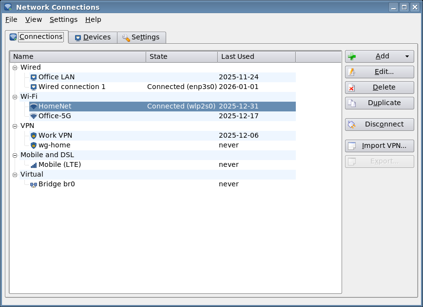

> **Vibecode disclaimer.** This project was written largely by an AI coding
> assistant (Claude Code), with a human giving direction ("vibe coded"). It
> has been built and tested against a real NetworkManager and against a
> simulated one, but the code has **not** been carefully reviewed or audited
> by a person. It changes how your computer connects to networks and handles
> your Wi-Fi and VPN passwords. Use it at your own risk; it comes with no
> warranty of any kind (see [COPYING](COPYING)). Reviews, bug reports and
> patches are very welcome.

TDE's own `tdenetworkmanager` goes through an abstraction layer and supports
only part of what NetworkManager can do. tde-nmctl talks to NetworkManager's
D-Bus API directly (with dbus-1-tqt) and covers most of it.

## Features

**Tray applet** (`tde-nmctl-tray`, starts at login)

* Icon with the primary connection: wired, Wi-Fi signal strength, mobile,
  VPN padlock, limited connectivity, connecting, offline, disabled
* Popup like plasma-nm: active connections with address, speed or signal,
  *Disconnect* and an information button; Wi-Fi networks in range (saved
  and strongest first, security, band) with *Connect*; *Connect to Hidden
  Network*; VPN, WireGuard and other connections; switches for networking,
  Wi-Fi and mobile broadband; *Edit Connections*
* Connecting to a new Wi-Fi network asks for the password and stores it in
  TDE Wallet; enterprise networks open the editor
* **Secret agent**: hands passwords from TDE Wallet to NetworkManager and
  asks for missing ones (Wi-Fi, 802.1X, VPN, SIM PIN, ...)
* Connection information (addresses, DNS, driver, speed, traffic and rate),
  notifications (KNotify), tooltip
* Asks once whether to turn off TDENetworkManager's autostart

| | | |
|---|---|---|
| 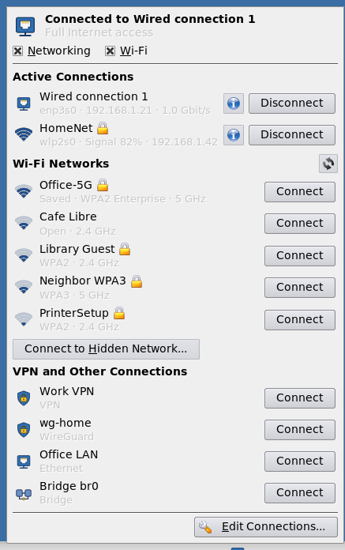 | 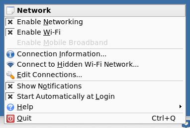 | 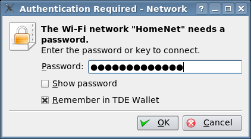 |

**Connection editor** (`tde-nmctl`, `tdecmshell nmctl`)

* List grouped as wired, Wi-Fi, VPN, mobile and virtual, with state and last
  use; add, edit, delete, duplicate, connect/disconnect
* Import and export of VPN configurations (OpenVPN `.ovpn`, WireGuard `.conf`,
  vpnc) through the NetworkManager plugins
* Connection types: **Ethernet**, **Wi-Fi** (client, hotspot, ad-hoc, mesh),
  **WPA/WPA2/WPA3 Personal**, **WPA/WPA2/WPA3 Enterprise**, WEP, LEAP, OWE,
  **802.1X** (TLS, PEAP, TTLS, PWD, LEAP, FAST) for Wi-Fi and wired,
  **VPN** (OpenVPN, vpnc, OpenConnect, L2TP, PPTP, strongSwan, Libreswan,
  Fortinet, SSTP, SSH, with every plugin option), **WireGuard** (key
  generation, peers), **mobile broadband** (GSM/LTE, CDMA), **DSL/PPPoE**,
  **InfiniBand**, **bond**, **bridge**, **team** (with their ports), **VLAN**,
  **dummy**, **Wi-Fi hotspot**
* Settings: autoconnect and priority, users, VPN started with the
  connection, firewalld zone, metered, cloned MAC, MTU, link negotiation,
  Wake-on-LAN, band/channel/BSSID, power saving, PMF, **IPv4/IPv6** (methods
  including shared, addresses, gateway, DNS, search domains, static routes,
  DHCP client ID and host name, privacy extensions), proxy
* Per-password storage like nm-connection-editor: TDE Wallet (this user),
  all users, ask every time, not required
* **Devices** tab: state with the reason of failures, driver, firmware, MAC,
  speed, addresses, DNS, live traffic, Wi-Fi networks with channel and BSSID,
  managed/autoconnect switches
* **Settings** tab: networking, Wi-Fi and WWAN switches, connectivity check,
  host name, default password storage, tray options
* polkit-tqt shows beforehand which changes need the administrator's
  password and warns when no polkit agent runs
* Command line: `tde-nmctl --list`, `--show <connection>`, `--edit
  <connection>`, `--new wifi`, ...
* A handbook in KHelpCenter and man pages `tde-nmctl(1)`, `tde-nmctl-tray(1)`

| | |
|---|---|
| 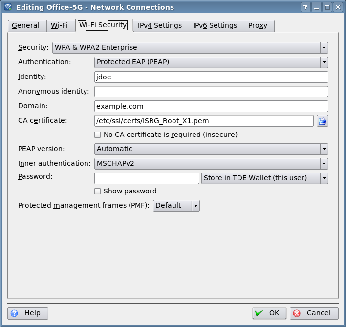 | 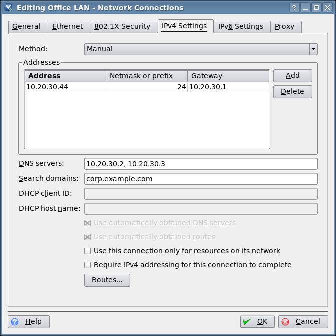 |
| 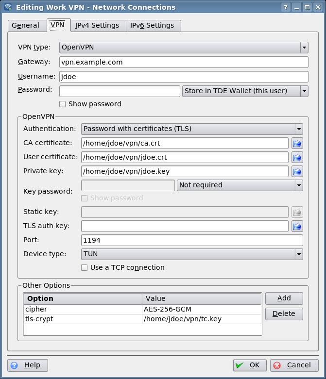 | 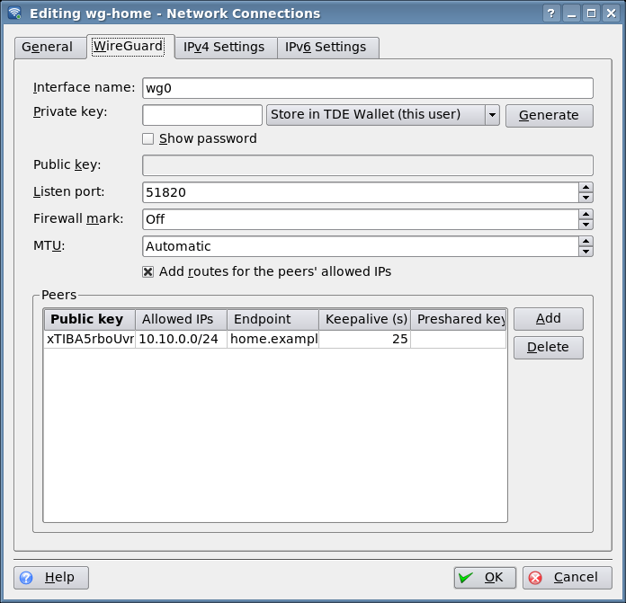 |
| 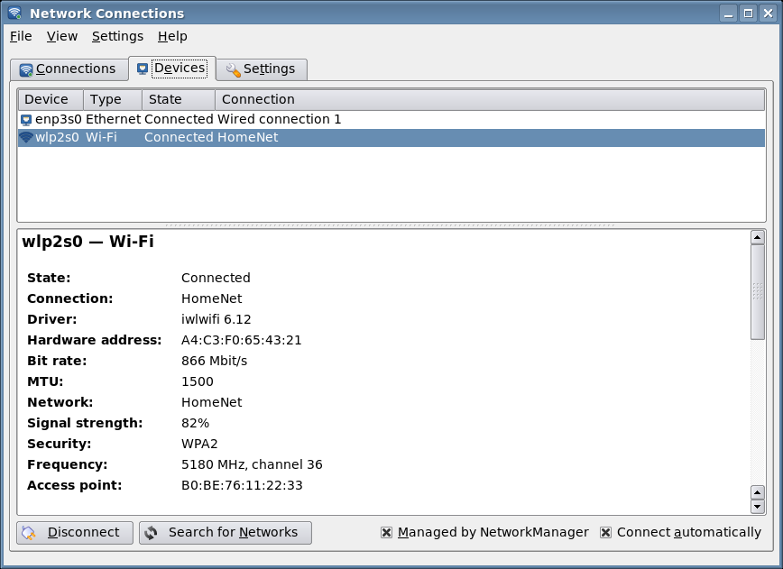 | 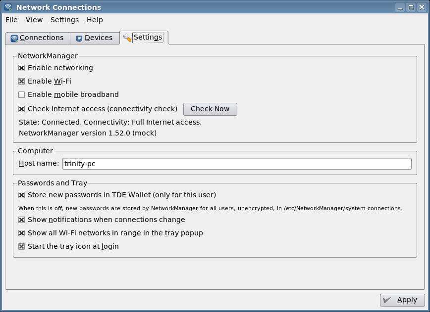 |

**Control Center and System Settings**: *Internet & Network → Network
Connections* in kcontrol, *Network & Connectivity → Network Settings →
Network Connections* in tde-systemsettings.

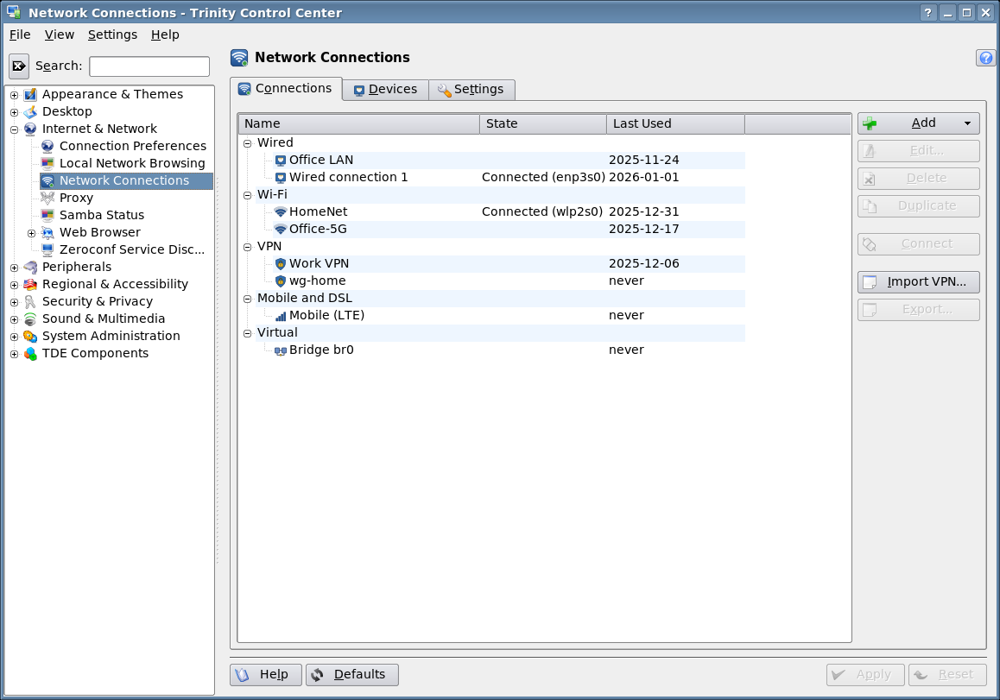

## Installing

Pre-built packages for **Debian 12 (bookworm)** and **Debian 13 (trixie)**
are attached to the artifacts of the *Build Debian packages* workflow and, for
tagged versions, to the [Releases](https://github.com/Yjlion/tde-nmctl/releases):

```sh
sudo apt install ./tde-nmctl-trinity_*.deb
```

NetworkManager must be running (`systemctl enable --now NetworkManager`), and
a polkit agent such as `polkit-agent-tde` should run in the session. Install
the VPN plugins you need, for example `network-manager-openvpn`.

## Building

Build dependencies (from the Trinity repository): `tde-cmake`,
`tdelibs14-trinity-dev`, `libtqt3-mt-dev`, `libtqtinterface-dev`,
`libdbus-1-tqt-dev`, `libpolkit-tqt-dev`, plus `cmake`, `pkg-config` and
`libdbus-1-dev`.

```sh
mkdir build && cd build
cmake .. -DCMAKE_INSTALL_PREFIX=/opt/trinity
make
sudo make install
```

Or build the Debian package with `dpkg-buildpackage -us -uc -b`.

CMake options: `-DWITH_POLKIT=OFF` builds without polkit-tqt,
`-DBUILD_TESTS=ON` builds `tests/clienttest`, `-DBUILD_DOC=OFF` skips the
handbook.

## Testing

`tests/mock-nm.py` imitates NetworkManager on the D-Bus system bus, with a
wired and a Wi-Fi device, access points, saved and active connections and
the secret agent protocol. Inside a container (as root):

```sh
tests/run-tests.sh build/tests/clienttest build/src/app/tde-nmctl
```

checks reading the state, writing connections of all value types, secrets,
the secret agent and the switches. `tests/roundtrip.sh` opens every
connection in the editor, saves it unchanged and compares the result, against
the mock or, with `REAL_NM=1`, against a real NetworkManager filled by
`tests/real-nm-profiles.sh`. `tools/take-screenshots.sh` makes the
screenshots under Xvfb.

## How passwords are handled

Secrets whose NetworkManager flag is *agent-owned* (the default for new
passwords, *Store in TDE Wallet*) are never given to NetworkManager to store.
They are kept in the network wallet, folder `tde-nmctl`, one map per
connection and setting (`<uuid>;<setting>`), and the tray's secret agent
answers NetworkManager's requests from there, only for requests from
NetworkManager itself. Secrets stored *for all users* are kept by
NetworkManager in `/etc/NetworkManager/system-connections`.

## License

GPL-2.0-or-later; the handbook is also available under the GFDL 1.2.
